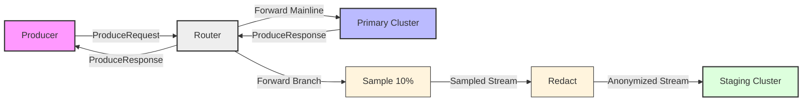
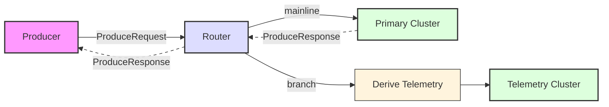
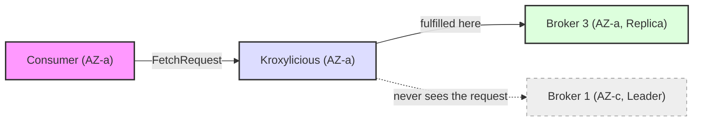

[Post 1]() introduced the Routing API: instead of a fixed pipe from client to cluster, the proxy interprets the Kafka protocol and can route traffic wherever you need it to go. [Post 2]() covered **connection switching** — the simplest use of that capability, where the proxy picks *which* cluster a client connects to at connection time, and can switch it without the client noticing.

This post is about the next pattern: **stream branching**. Where connection switching makes routing decisions that last a connection's lifetime, stream branching goes further — the router can invent additional connections the client never asked for, and send traffic down them alongside or instead of the primary. We'll look at what that buys you, the golden rule (the mainline is the source of truth, branch lines are best effort), where it breaks, and when to get off the train.

If it helps to have a mental model: think of a railway network — Post 1 introduced it and we'll keep riding it. The client's stream is the express running down the mainline. At each station, the stationmaster can inspect passing traffic, re-route it to a different platform, or dispatch a whole new but very similar train down branch lines to other destinations — all without stopping the express or telling the passengers anything changed (they might notice however).

## The express doesn't wait

There is one golden rule in stream branching. Everything else in this post follows from it:

> **The mainline is the source of truth. Branch lines are best effort.**

The simplest possible branch is a pure duplication router. The client produces to the primary cluster; the router silently sends an identical copy to a second cluster. The client sees only the primary's acknowledgement and has no idea the second write happened.

graph LR
    subgraph Infrastructure []
        direction LR
        Producer[Producer]
        Router[Router]
        Primary[Primary Cluster]
        DR[DR Cluster - Identical Copy]
    end

    Producer -- "Produce" --> Router
    Router -- "(mainline)" --> Primary
    Router -- "(branch)" --> DR
    Primary -- "produce response" --> Router
    Router -- "produce response" --> Producer

    linkStyle 3 stroke-width:1px,stroke-dasharray: 5 5
    linkStyle 4 stroke-width:1px,stroke-dasharray: 5 5

    style Producer fill:#f9f,stroke:#333,stroke-width:2px
    style Primary fill:#dfd,stroke:#333,stroke-width:2px
    style DR fill:#ffd,stroke:#333,stroke-width:2px
    style Router fill:#ddf,stroke:#333,stroke-width:2px

![
                                   ┌──(mainline)──► [ Primary cluster ]  ──ack──┐
[ Producer ] ──Produce──► [ Router ]                                            │
     ▲                             └──(branch)────► [ DR cluster ] (identical copy)
     │                                                                          │
     └──────────────── ProduceResponse (primary's verdict only) ◄───────────────┘
](/assets/blog/images/routing-series/naive-dr.svg)

Yes, I know this looks like a DR solution, it's really not. By definition the branch is a best-effort copy; the DR cluster can have holes and duplicates that the primary doesn't — [Mind the gap](#mind-the-gap) goes into the gory details. You can't trust it for failover — the only way to verify nothing's missing is to compare both copies, and if both copies are online you don't need to fail over. If you need reliable replication to a DR cluster, use MirrorMaker 2 or [KIP-1279](https://cwiki.apache.org/confluence/display/KAFKA/KIP-1279%3A+Cluster+Mirroring) cluster mirroring — they were designed and built for that job.

Cloning a feed to a staging environment is the trivial example, even though audit and telemetry are the more likely reasons to branch in practice. You get a complete-ish copy of production traffic to test against real-shaped data, and the odd missing record doesn't affect whether your code works. It's also the branch you'd most expect to have a bad day, and that is exactly what the golden rule is for.

And why would staging have a bad day? Your staging cluster is big enough for your production load, right? No, I thought not. As described in [Post 1](), routers exist in a DAG; each node has a filter chain, a composable pipeline of steps that can inspect and transform requests as they pass through. Add a sampling filter on the staging branch that drops 90% of produce requests and forwards the rest. The mainline is untouched; staging gets a 10% sample; nobody had to change any application code.

Speaking of filter chains: your production data is full of PII that can't touch staging. Add a redaction filter after the sampler — no point scrubbing records you're about to throw away. The filters compose.




![
                                   ┌──(mainline)──► [ Primary cluster ]  ──ack──┐
[ Producer ] ──Produce──► [ Router ]                                            │
     ▲                             └──(branch)──► [sample 10%]──► [redact]──► [ Staging cluster ]
     │                                                                          │
     └──────────────── ProduceResponse (primary's verdict only) ◄───────────────┘
](/assets/blog/images/routing-series/staging-branchline.svg)

So far we have talked about taking the original record and forwarding it somewhere. That's powerful, but why stop there? Filters can observe, transform, or act on requests — and what's the use in observing a record without making that observation visible somewhere? We are all Kafka fans here, so of course we send our telemetry via Kafka too. A branch can derive some interesting information from the produce request and send it merrily on its way to the telemetry cluster.




![
                                   ┌──(mainline)──► [ Primary cluster ]  ──ack────────────────┐
[ Producer ] ──Produce──► [ Router ]                                                          │
     ▲                             └──(branch)──► [derive telemetry]──► [ telemetry cluster ] │
     │                                                                                        │
     └──────────────── ProduceResponse (primary's verdict only) ◄─────────────────────────────┘
](/assets/blog/images/routing-series/telemetry-branchline.svg)

The branch writes belong to the router, not the client. The client didn't send them, never sees their responses, and has no idea they exist. The router opens its own connections to branch targets, dispatches its own copy of the request to each, and decides what to do when they fail.

That's the normal contract: branch writes are fire-and-forget from the client's perspective. A filter *could* stall the `ProduceResponse` until a branch acks, but that just buys you the latency hit without any kind of atomicity guarantee. [Mind the gap](#mind-the-gap) explains why.

## Replica routing: per-request dispatch

So far we've focused on produce requests. Branching on the fetch side took me a while to realise the value of, but there are two cases worth a look.

The first is a branch driven by the response: the primary's `FetchResponse` goes back to the client, and the router also sends a small record of what was read (per-consumer bytes, lag, an audit trail of who read what) down a branch line. The catch is that a delivered fetch isn't a processed one, and a refetch counts the same records twice. If you need to know the group member really acked, tap its `OffsetCommitRequest` as well: the request says what the member claims to have processed, and the `OffsetCommitResponse` says whether the broker accepted it.

The second is a shadow fetch: the router sends its own read-only fetch to a candidate cluster, say to validate a passive site is in sync with the active site. The client only cares about the primary's response. The router can compare the shadow response with the primary and summon help if they aren't identical. We don't need to check every response; a sample would work well here. It needs the offsets to line up between the two clusters, and the shadow must never be allowed to hold up the mainline. Both are forgiving in a way the produce side isn't. Neither is a copy of the client's data, so there's no ghost or MIA (missing in action) batch to reconcile.

Branching isn't the only thing worth doing on the fetch side though. Sometimes the better move is to change where the fetch goes — not to a different cluster, but to a different broker on the same one. That's a substitution, not a branch: one stream, better-routed.

Kafka supports rack awareness, and if you're running in the cloud you really do want it on — egress costs can be punishing. But to get it working you have to ensure every application uses `client.rack` with the correct values. If you're anything like me, you hate playing config whack-a-mole. A layer 7 proxy, one that understands the Kafka protocol, can centralise this.

There's one subtle obstacle though: even if a filter can see that a `FetchRequest` belongs in `eu-west-1a`, knowing that isn't enough. The client dialled broker 1 in `eu-west-1c`, so all its traffic must flow there. A filter could stamp a `rack_id` onto fetches from a misconfigured client. If the brokers are running `RackAwareReplicaSelector` the client will be pointed at a nearby replica, at the cost of an additional round trip now and again to redirect it. That only works if someone has configured the brokers for it. A router needs neither the brokers' help nor the client's. Given its own idea of which broker lives in which rack, it can send the fetch straight to a nearby replica, with no redirect. The Routing API makes that possible: the backend connection is no longer fixed at connection time, it can be chosen per request. We can now redirect the fetch to the broker in the appropriate rack rather than the one the client asked for.

A `FetchRequest` payload just says "partition 3, from offset N". The broker ID is encoded by *which connection* the client sends it on — that's the seam a custom router can exploit. When the `FetchRequest` arrives on the broker 1 connection, the router inspects the partition's replica set, sees that broker 3 is in the same AZ and fully caught up, and asks the runtime to dispatch it down the route for what it calls broker 3 instead — the runtime handles the rest:




![
[ Consumer (AZ-a) ] ──Fetch──► [ Kroxylicious (AZ-a) ] ────► [ Broker 3 (AZ-a, Replica) ]
                                       │
                                (Skips AZ tax)
                                       ▼
                              [ Broker 1 (AZ-c, Leader) ]  ← never sees the request
](/assets/blog/images/routing-series/replica-routing.svg)

The router can do what it thinks is best here: it can honour a client rack, ignore it, or invent one if the client didn't set it. A router doesn't need to trust what the client says about its own location; it can route correctly regardless. The request payload is untouched, the original broker never receives the fetch, and the cross-AZ charge never reaches the invoice. What makes that possible: the proxy can hold two backend sockets — one to the leader, one to the local replica — and choose between them per request. To the client, that's still one broker on one cluster.

One constraint the dispatcher can't escape: **proxy placement**. If the proxy is in `eu-west-1b` and the consumer is in `eu-west-1a`, pulling from a broker in `eu-west-1a` still costs a cross-AZ hop to reach the proxy first. There's no hyperspace jump. For replica routing to pay off, the proxy fleet needs to be co-located with the clients it serves. You will know this already from the post on [connection switching]().

One more constraint, this time from the protocol. Normally a fetch session lives on the broker that created it, so an incremental fetch only makes sense to that broker. If the router sends a partition's fetches to a different broker than last time, the new broker has never heard of the session. The Java client treats that as recoverable. It falls back to a full fetch and carries on, but each change costs a failed round trip. So pick a replica and stick with it unless you have a good reason to move.

There's room to go further. Someone might want to explore using out-of-band telemetry — OTel metrics, say — to route fetches based on broker load within the set of in-sync replicas in the same AZ. Proximity routing alone already solves a real, expensive problem; load-aware routing within that constraint is an open question worth exploring.

## Cheap, branching is not

Routing decisions themselves are cheap — inspecting a header, picking a route, forwarding bytes. Substitution patterns like replica routing stay in that lane: one request, one response, different route, minimal overhead.

Inventing new requests is where we start incurring noticeable costs. Every branch is additional traffic on the wire, and if a filter needs to inspect or transform record content, you're paying CPU and memory costs too — decompress the batch, deserialise every record, do your work, re-serialise, recompress. On a busy topic with `zstd` batches that's real CPU, inline on the proxy, for every batch that takes the branch. Size your proxy fleet for the most expensive station on the line, not for the mainline.

Branching can have other awkward memory effects. The client's request/response is over as soon as the mainline acks, but the router may need to hold on to the request after it has sent the response to the client. Depending on the router, it could need to keep it until every related branch is done. So the memory pressure can, and likely will, outlast the exchange the client sees, and the slower the branch, the longer it stretches. It's obvious, but worth stating: more branches means more to hold, for longer.

Keep it self-contained. Every station handles each batch on its own, acting on each request and response as it passes. Joins, windows, and aggregations over time need state that survives restarts, rebalances, and late data — Kafka Streams and Kafka Connect exist to manage exactly that. A router that starts accumulating state across batches has become a badly built stream processor, and badly built stream processors are how senior engineers get paged at 3am.

## Egress, ingress, or does it matter?

[Post 2]() asked whether the proxy belongs on the client side of the link (egress) or the broker side (ingress), and for DR the answer was egress: a proxy that dies with the primary can't flip anything. That argument carries over unchanged, and probably matters more. Stream branching adds a second question: what is the branch local to? The protocol doesn't care where the proxy sits, but the branch target is usually closer to one end of the link than the other. The rule of thumb: all else being equal, put the proxy close to the thing you're branching to.

Your topology will have opinions of its own:

- **Staging** sits next to production, so the proxy goes at the broker end and the shadow never crosses the link. **Audit** goes there too: if the brokers are only reachable through the proxy, nobody can opt out of being audited.
- **Telemetry** can go either way. If the observability stack lives with the clients, so does the proxy.

Redaction follows the trust boundary instead. Say your telemetry feed goes to in-house storage with the IP addresses intact, and a copy goes to a third-party anomaly detector minus the PII. The scrubbing has to happen before the copy leaves your domain, so the proxy goes wherever that exit is. Flip it round and redact what an untrusted client is allowed to read, and the proxy lands at the broker end. Same filter, opposite ends of the link.

Replica routing isn't really an ingress or egress question at all. The consumer, the proxy and the replica it fetches from all need to share an AZ, otherwise the cross-AZ hop just moves to a different leg. That's the **proxy placement** constraint from earlier, and it holds whichever end of the link the proxy sits at.

## Mind the gap

Stream branches generally take the form of a dual write, and dual writes are like juggling with knives. Fine as long as you catch the hilt, painful if you catch the blade.

### There is no undo

A Kafka log only ever appends. When a batch lands on one cluster and fails on the other, nothing can take the successful write back. That leaves the branch out of step with the primary in two ways, and we'll need names for them:

- An **MIA (missing in action) batch** is one the primary has and the branch doesn't. The branch is behind, and has a hole.
- A **ghost batch** is one the branch has and the primary doesn't. The branch is ahead, and if the client retries it becomes a duplicate on the branch.

There are three ways to sequence the branch write, and it is worth understanding what each one actually buys you.

The simplest is **fire-and-forget**: one produce request in, one mainline produce request out, plus however many branch copies you want to send. This is a best-efforts pattern, and the edge cases are more common than a casual inspection might imply.

To mitigate some of those, there is **dispatch on ack**. The router captures a copy of the client's produce request on arrival and forwards the mainline request. When the ack comes back from the mainline broker, the router replies to the client and then dispatches the branch copies asynchronously. Because the branch only ever receives batches after the mainline has committed them, ghost batches are eliminated — with one caveat: if the primary committed but the ack was lost in transit, the client retries, the mainline deduplicates, and the router dispatches a second branch copy on the second ack. The mitigations aren't universal:

- **Acks are per partition.** A produce response can be a partial success; what do we dispatch then? Everything? Just the ones that worked? It all depends on what is going to the branch. If your branch is generating an audit trail or telemetry of successful writes, dispatching only the successes is exactly what you want. The router simply decomposes the original request and rebuilds a new batch containing only the successful partitions on the fly.
- **Duplicates are still possible.** The client might still retry, if for any reason the ack the proxy sent never reaches the client. The client will retry, the mainline broker will discard the duplicates and ack again, and the router dispatches a second branch copy (because it gets the acks). No ghost was involved, and the branch still ends up with a duplicate.
- **`acks=0` has nothing to trigger on.** Those producers never get a response, so we have nothing to dispatch on. Fire-and-forget is likely fine here, however.

The obvious next step is to wait for the branch acks too before replying to the client. It doesn't work. The primary has already accepted the batch, so you have to send that ack to the client regardless — there is no rolling it back. All that's happened is the client waited longer to receive the same ack it would have got anyway, and the failed branch write is still there to deal with. This holds whether you used fire-and-forget or dispatch on ack as the trigger.

We can lay out what each of the first two patterns does with the tables below. To keep them readable I'm dealing in whole requests and ignoring partial successes.

**Fire-and-forget**

| Primary | Branch | Client sees | Branch ends up with |
|---------|--------|-------------|---------------------|
| ✅ | ✅ | Success | A copy. The happy path. |
| ✅ | ❌ | Success | An MIA batch: a hole |
| ❌ | ✅ | Error, so it retries | A ghost batch now, and a duplicate after the retry |
| ❌ | ❌ | Error, so it retries | Whatever the retry produces |

**Dispatch on ack**

| Primary | Branch | Client sees | Branch ends up with |
|---------|--------|-------------|---------------------|
| ✅ | ✅ | Success | A copy. The happy path. |
| ✅ | ❌ | Success | An MIA batch: a hole |
| ❌ | ⛔ | Error, so it retries | Nothing — the branch write wasn't dispatched |
| ❌ | ❌ | Error, so it retries | Whatever the retry produces |

The MIA batch is the one people expect: the branch falls behind and nobody tells the client. The ghost batch is the one that catches people out. In the ghost case the primary returned an error (or the ack timed out), so the client was told the batch failed, but the branch write already went through. If the client gives up, the ghost stays on the branch for good. If it retries, the primary ends up with one copy, deduplicating the retry if the first attempt had actually landed. The branch receives the retry as a fresh write from the router, so unless the router has done the extra work described below, the ghost becomes a duplicate the primary doesn't have.

So in normal running the branch both loses data *and* duplicates it, independently of the primary. If that makes you uncomfortable, good — it should. Copy fidelity is why everyone wants Kafka; dual writes trade it away. That's a legitimate trade-off for the right use case, but it needs to be a conscious one.

### Backpressure: drop or block?

So if we aren't holding back the client's ack until the branch has acked, can we just ignore the branch? Not quite. The primary is healthy, staging is struggling, and unsent branch writes are piling up in the proxy. We can't buffer forever: we're a proxy, not an AI datacentre, and RAM is finite. Running out of it takes the mainline down with the branch. So we monitor the backlog, and when it grows we have two choices:

- **Drop.** Throw away branch writes until the branch catches up. The mainline is unaffected; the branch gets a hole. This is the right default for nearly every branching use case, and it's what "best effort" actually means in practice. Note that if the branch is an idempotent producer, dropping a batch forces the router to discard that branch PID (or bump the producer epoch) and pay the re-init penalty before the next write can go through — many auxiliary branch pipelines intentionally use `enable.idempotence=false` or `acks=1` to allow lossy drops without stalling the sequence.
- **Block.** Stop reading from the client until the branch drains. The branch stays more complete, but the mainline now slows to match it. You've coupled the two clusters and still don't have a fidelity guarantee, so this is a hard trade to justify. If you have a use case that needs it, do get in touch and tell us about it.

Whichever you choose, keep an eye on the queue. A branch that's quietly falling behind looks just like a healthy one right up until someone needs it, so export queue depth and drop counts as metrics and you'll see the trouble coming.

### Partitions don't have to line up

The client picked a partition using the *primary* topic's partition count, and the branch topic doesn't have to agree. If it does, partition *n* simply maps to partition *n* and per-key ordering comes along for free. If it doesn't, the router is now repartitioning: somebody has to decide where each record lands, and the branch's ordering is only as good as that decision. Derived streams, like an audit feed keyed by user rather than by order, will usually end up here. That's fine, as long as you meant it.

### Multiple connections make multiple problems

Kafka producers use idempotent delivery by default. The broker deduplicates retried writes using a Producer ID (`PID`) assigned at initialisation plus a per-partition sequence number on every batch. Same PID, same sequence number — the batch was already committed, discard it quietly. The client never needs to know. Everything below assumes an idempotent client, which is the default. A non-idempotent client sends no sequence numbers at all. If you've turned that off, you already know what you've signed up for — branching doesn't make it worse, but it can't help either.

**Pass the client PID.** The client negotiated its PID with the primary cluster; the router passes it through unchanged, exactly as in connection switching. Every write carrying the client's identity goes to the cluster that issued it. Nothing to map, nothing to invent, nothing to lose. Not having to translate it is a large part of what separates branching from weaving — once one client identity has to be valid on several clusters simultaneously, the proxy is translating something far less forgiving than a node ID. That's a problem we cover in more depth in weaving posts.

#### The router is its own producer on the branch

The branch cluster's identity is something the router created. The client doesn't know the branch cluster exists and nothing downstream will ever try to resume or share that identity. The router sends its own `InitProducerIdRequest` to the branch cluster and owns that identity start to finish. This is safe *because* the client can't see it — an identity the client can't see is one the client can't collide with. It also means the client's batches can't simply be forwarded down the branch. The router has to build each branch batch itself, stamped with its own PID and epoch and a fresh checksum.

Order matters too. Anything that binds a batch's body to its headers, such as encryption that authenticates the batch identity, has to be applied to the batch exactly as the broker will persist it. Change the headers afterwards and the binding no longer holds, probably in unrecoverable ways. The binding can happen at any node in the DAG, but once it has, nothing downstream may change the batch or the records in it. The runtime can't readily police conflicting manipulations, so it's up to whoever writes the configuration to get the order right.

To the branch cluster, the router is just another idempotent producer. For each PID and partition, the branch broker remembers the last few batches it accepted, discards any it has already seen, and rejects anything that isn't the next one in line. It's the same check the primary applies to the client.

#### Filters that change the batch count break the numbering

Supporting idempotent producers on a branch line is no different from supporting them anywhere else in the filter chain, though the problems are much more obvious here. A filter that adds or removes batches breaks the numbering, so it has to manage the sequence itself.

That's hard on the mainline, where the client's PID outlives the connection. Say the client sends 100 batches and a filter forwards a sample of 10, numbered 0 to 9. The network drops and the client reconnects with batch 101, sequence 100. The broker is expecting sequence 10, but a stateless filter has no idea it ever sent ten. Getting that right means keeping the sequence somewhere that survives the connection, a KV store say, and the runtime won't do that for you.

The branch line has the same problem and a much cheaper way out. The PID is ours, and we're best-effort publishers, so we can skip the external state: a new connection gets a new branch PID, the filter starts again from zero, and we accept a duplicate or a hole around a reconnect. If that isn't good enough, the fix is the same as on the mainline, state kept outside the proxy.

Gaps matter in the other direction too. If the router uses a sequence number for a branch batch that is then dropped or fails for good, the next batch for that PID and partition no longer lines up, and the branch broker rejects it. A "hole" can really be a stall: everything after it on that PID is refused until the router starts again with a fresh PID.

#### One client, many connections, many branch identities

**Branch PIDs are tied to a connection.** The router's branch PID lasts only as long as the client connection it was negotiated for. Unless something outside the proxy remembers it, it's gone when the connection closes, and the next connection negotiates a fresh one. And the client has one PID but several connections: a producer opens one to each broker that leads a partition it writes to, and in a horizontally scaled proxy fleet those connections can land on different proxy instances. The routers serving those connections can't coordinate with each other, so each one negotiates its own PID with the branch cluster. One client identity on the primary becomes several unrelated identities on the branch.

That's harmless while each partition's traffic stays on one connection. It stops being harmless when the traffic moves — and in Kafka, traffic moves routinely:

- **Reconnects.** A network blip, an idle timeout, a broker restart, a proxy rolling upgrade: anything that drops the client's connection drops the branch identity with it. The client reconnects and resends its in-flight batches — some of which had already reached the branch under the old PID. They arrive under a new PID, and the branch accepts them all as fresh writes. Reconnecting to the same proxy instance doesn't help, because the old connection's state is already gone.
- **Leadership changes:**
  1. A partition's leader moves from broker 1 to broker 2.
  2. The client retries its last in-flight batch to broker 2, using the same PID it used with broker 1.
  3. The connection to broker 2 has its own router, with its own branch PID.
  4. The mainline broker has already seen that batch from that PID, so it discards the duplicate.
  5. The branch broker has never seen this router's PID, so it accepts the batch. It's a duplicate, but nothing marks it as one.

Both are the same failure. The client's retries for a partition move from one branch identity to another, and the branch can only deduplicate within a single identity. The mainline is unaffected — its PID belongs to the client, which holds it across every connection, every proxy instance, and every reconnect, so the primary recognises retries and discards the ones it has already committed.

You could fix this inside one process by letting the routers share a PID cache. But nobody[^single-proc] runs a single proxy process in production, and across processes there's nothing to share. For that you need an external state store.

The runtime is stateless, so none of this is fixed for you. A filter that wants to resume the same branch identity after any of these has to bring its own state store, and that's on you. It fixes the duplicates but not the ghosts and MIA batches:

| What happens | Stateless | With a state store |
|--------------|----------------|--------------------|
| Ghost batch, then the client retries | Duplicate on the branch | The retry maps to the same branch sequence, so the branch discards it |
| Client reconnects and resends in-flight batches | Duplicates | One copy |
| Leadership change moves the partition to another connection | Duplicates | One copy |
| Proxy restarts or rolls | Duplicates | One copy |
| Ghost batch, and the client gives up | The ghost stays | The ghost stays |
| MIA batch (dropped, or permanently failed) | A hole | A hole |
| Router dies between the branch write and the state store update | Not applicable | Record first, then send: a hole. Send first, then record: a duplicate |

A state store takes the duplicates away and adds a dependency on the hot path, and it leaves the ghosts and MIA batches where they were. Without one, leadership changes, reconnects, and rolling upgrades are routine, so duplicates on the branch are a normal part of running stream branching, not an edge case you'll rarely see.

One thing may help. [KIP-1313](https://cwiki.apache.org/confluence/spaces/KAFKA/pages/406624038/KIP-1313+Client+instance+ID+in+all+request+headers) (accepted, not yet released) puts a client instance ID in every request header, which gives a router a stable identifier to key its state on across connections and proxy instances. It's an identifier, not a branch PID, so the router still has to manage the branch PID itself.

Use shadow data for observability, not for accounting. If someone needs to reconcile the branch against the primary to the last record, the answer is replication, not branching.

### Transactions don't branch

A transaction belongs to one cluster. The coordinator, the transaction log and the commit and abort markers all live there, so a branch on another cluster has nothing to take part in.

The router can see that a batch is transactional, because it's marked as such. What it can't see from the produce stream is the transaction's state: whether it's open, which one it is, and how it ends. That lives with the coordinator, and the commit and abort markers are written by the broker, not sent by the client. The router can copy the records but not the verdict.

That leaves two bad options for a transactional branch:

- **Strip the transactional flag** and write the branch batches as plain idempotent writes. This throws away the semantics consumers rely on. There's no commit or abort to say where a transaction ends, so records from transactions the primary later aborts are visible on the branch immediately. A `read_committed` consumer there reads data that, as far as the primary is concerned, never happened.
- **Run a shadow transaction** on the branch: the router starts its own transaction against the branch cluster's coordinator and tries to follow the primary's. It can't be faithful. The branch transaction is a separate transaction with its own producer ID, epoch and timeout, so it can commit or abort independently of the primary's. What a `read_committed` consumer sees on the branch needn't match what it would see on the primary. Post 1 said it bluntly and it still holds: the Kafka protocol has no cross-cluster transaction coordinator, and routing can't invent one.

Cloning a transaction doesn't work, but that doesn't make branching during transactions pointless. The branch sees everything, committed or not. If whatever reads the branch can live with that, it's fine. If it can't, routing isn't the solution you're looking for: you need replication.

## Know when to get off the train

Staging shadows and derived telemetry are the sweet spot: stateless, auxiliary, where the odd gap or duplicate is a curiosity rather than a crisis. If you need the derived stream to be stateful — joins, windows, sessionisation — Kafka Streams or a Connect pipeline will serve you better; they were built to manage state across restarts and rebalances, a proxy wasn't. If you need a complete, ordered, offset-consistent copy on another cluster, use replication: MirrorMaker 2, KIP-1279, or your vendor's equivalent reads the committed log after the fact and doesn't have the asymmetric failure modes above. If you need writes across clusters to be atomic, the answer is the same — no amount of clever routing changes what the protocol can and can't coordinate.

The distinction between mainline and branch isn't incidental, it's the whole contract. Keep it legible and stream branching is a cheap way to build streams nobody had to produce. Let it blur and you've scheduled a conversation nobody will enjoy.

---

Both flow patterns are now covered. Connection switching picks the track. Stream branching adds branch lines. Next we leave the railway for the sorting office: **topic weaving**, where the router no longer just directs streams but decides which topics exist, where they live, and what they're called. Producer identity comes up again there, and this time the client *does* know about every cluster involved.

If you're branching streams already, or want to and have hit a gap this post didn't cover, find us on [GitHub](https://github.com/kroxylicious/kroxylicious), [Slack](https://kroxylicious.slack.com), or [Bluesky](https://bsky.app/profile/kroxylicious.io).

[^single-proc]: Except on localhost during a Friday demo.
