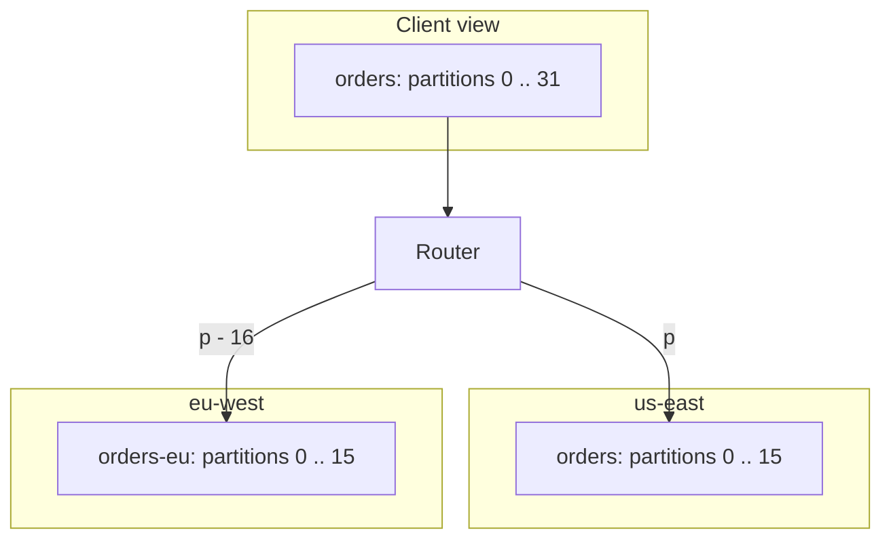
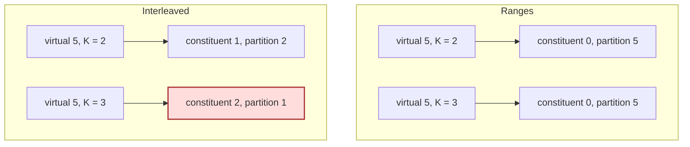
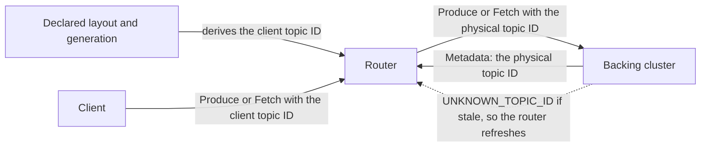
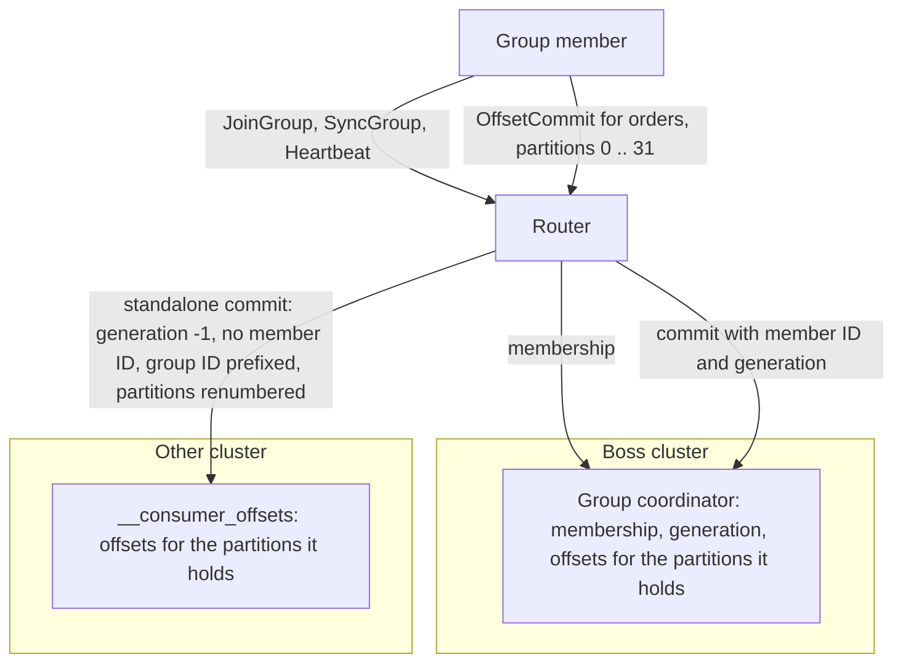

This is the fifth post in a series about routing in Kroxylicious, and it covers the last of the four patterns [Post 1]() named: [connection switching](), [stream branching](), [topic weaving]() and partition weaving. Like the rest of the series, this is design-level thinking rather than a description of something shipped, and we haven't tried any of it.

Partition weaving is a cautionary tale. My first reaction was "that's a really neat idea". The more I looked at it, the harder it got. It is clearly part of the design space the Routing API opens up, which is why it's in the series, and it may well be possible. But it is a lot of effort to go to, and I haven't found a use case that justifies it to me. If you have one, I'd like to hear about it.

## One topic, two clusters

Take the scenario from Post 1: a risk engine in us-east, hardcoded to read a topic called `orders`, and an EU team producing to `orders-eu` on a local cluster. The router presents both as one `orders` topic with 32 partitions. Partitions 0 to 15 are the `orders` partitions on us-east. Partitions 16 to 31 are partitions 0 to 15 of `orders-eu` on eu-west. A consumer that asks for partition 20 gets partition 4 of `orders-eu` and never knows. I'll call the numbers the client sees *virtual*, in the same sense as a virtual cluster, and the partitions and topics that actually exist on a backing cluster *physical*. Partition 20 is virtual, and partition 4 of `orders-eu` is the physical partition behind it.

Producers pick a partition by hashing the record key and taking the remainder after dividing by 32, so every record with a given key lands in the same partition, every time. Each cluster keeps its own offsets, so offset 54 only means something within its own partition.





The difficulty lives in one place: once we've numbered the partitions, we can't re-number them. Records stay in the partition they were written to, and the numbers we expose in `Metadata` are the only way a client can address them. Change the count, or what a number points at, and the data can't follow. Clients keep using the old addresses and read or write the wrong place.

## What would you use it for?

The best case I have is a migration, for moving a very large topic between clusters. The runtime gives you nothing for it today. None of the other cases are much better, and I've set each against the solution that would usually beat it.

**Moving a very large topic a piece at a time.** Replicate one range of partitions to the new cluster with something that preserves offsets, repoint that range, watch for a while, and repeat. This is connection switching with a finer lever, and it brings the problems from [Post 2]() with it, per range instead of all at once: committed offsets have to mean the same thing on the new cluster, and idempotent producers' sequence state stays behind. Compare it with connection switching for the whole topic, which is stateless and already exists. A range at a time buys you a canary, and it only seems worth building for a topic you are properly nervous about moving.

**A topic bigger than a cluster.** Clients see one topic with N partitions, keys hash as normal, and per-key ordering holds. But [topic weaving]() already spreads topics across clusters. Partition weaving only helps when a single topic outgrows what one cluster will hold or serve, and I'd want to look at that topic's design before building anything to accommodate it.

**The name-bound consumer.** This is the risk engine above. Most consumers can subscribe to more than one topic, and where this one can't, replicating `orders-eu` into the consumer's cluster does the same job. The weave saves you the replica. In exchange the consumer reads the EU partitions across the link on every fetch.

**Data residency by key.** This is the one people will suggest, and it fits worst. The default partitioner hashes keys without knowing where anything lives, so residency would need a custom partitioner that sends EU keys to EU partitions. Producers that already know the layout could write to separate topics, and topic weaving would stitch those together without any of this.

That's the list. If you have a better one, tell me.

## The layout is declared, not discovered

Everything else depends on where the partition layout comes from. For topic weaving the map could follow the clusters, because topics appearing and disappearing is something clients cope with. A partition count is different. A partition number is the only handle a client has on a record, and changing the handle without moving the data breaks all sorts of things.

Suppose the router discovered the layout by asking the clusters. If eu-west became unreachable, the router would find only 16 partitions and report a topic with 16 partitions. Every keyed record produced in that window would hash into 0 to 15, to the wrong partition, with no error anywhere. So I'd declare it. A woven topic is an ordered list of constituents, each a route, a physical topic and a partition count, held in the router's configuration or a catalogue. Three consequences follow:

- **The numbering has to be contiguous.** The default partitioner picks a number from 0 to N-1 using the count. A hole is a partition the producer will try to use and can't find.
- **An unreachable constituent still counts.** Its partitions stay in the `Metadata` response, reported with an error and no leader, the way a broker reports a partition whose leader is offline. N doesn't shrink because a cluster is down.
- **The declared count wins.** Kafka lets someone add partitions to the physical topic behind a constituent. The extra partitions stay invisible until the layout says otherwise.

Every proxy instance must give the same identity the same answer, as in Post 4. Because the layout is configuration, every instance has the same list, so there's no state to share.

Changing it is where the care goes. The rule is that a virtual partition number must keep meaning the same log. Appending a constituent to the end satisfies that: existing numbers don't move and the new ones are simply new. It does grow N, which changes where keyed records land, exactly as adding partitions to any Kafka topic does. Data already written stays where it is. If the new constituent is on a cluster the router has no route to yet, `numRoutes` changes too, and every virtual node ID moves with it, a coordinated reconnect for all clients of that VKC. A rolling update is tolerable for an append. An instance that hasn't picked up the change returns errors for the new partitions, and clients retry. Reordering, removing, resizing or relocating a constituent is a migration, and no amount of careful rollout makes it anything else. The piecemeal migration above is one of those, so it needs a deliberate cutover and not a config push.

## Two ways to number them

The first is **ranges**, which is what the picture shows. Constituent *i* starts at the sum of the partition counts before it. A virtual partition `p` falls in the range `[start_i, start_i + count_i)` and maps to physical partition `p - start_i`. The inverse adds `start_i` back. In the example, virtual 20 is `eu-west` / `orders-eu` partition 4. Constituents can have different counts, and appending to the end leaves everything before it alone.

The second is **interleaving**, and it's the tempting one, because it's the arithmetic from Post 2. With K constituents of equal size, virtual `p` goes to constituent `p mod K` as physical partition `p div K`. It looks like the node ID bijection and it's just as stateless.

Both are stateless. Interleaving isn't saving anything the declared list hasn't already saved, because the router needs that list to know the routes anyway. Where they differ is growth:

| | Ranges | Interleaved |
|---|---|---|
| Virtual 5 with K = 2 | constituent 0, partition 5 | constituent 1, partition 2 |
| Virtual 5 after a third constituent joins (K = 3) | constituent 0, partition 5 | constituent 2, partition 1 |

(Constituents are numbered from 0, and the ranges column assumes the first holds at least 6 partitions.)





Interleaving moves every virtual partition when K changes. The data hasn't moved. Committed offsets sit in `__consumer_offsets` keyed by the physical topic and partition, and earlier records were placed by an earlier hash. After the change the same virtual number reads from a different log. In Post 2 the same formula was safe because node IDs are re-learned from the next `Metadata` response. Partition identity is stored, so it can't be re-learned. Ranges are only growable at the end, but at least they know what that means.

Re-numbering isn't a quirk of weaving. Changing the partition count of a normal Kafka topic is already a risky business: a key whose hash is 50 lands in partition 18 of 32 and partition 2 of 48. Weaving doesn't make that any worse, but it does make an inadvertent change much more likely. Changing the configuration is a much more serious activity than it appears.

## Where the numbers appear

Partition numbers turn up in nearly every RPC that names a partition. I'm sticking to produce and consume, which is the data path, and leaving the admin APIs out. These are the requests where the router has to translate:

| Request | Where the partition number is | What the router does |
|---|---|---|
| `Metadata` response | Each partition's index, and its leader as a node ID | Emits virtual 0 to N-1. Sets each leader to a virtual node on the owning route, with an error for an unreachable constituent |
| `Produce` | The partition index under each topic | Maps virtual to (route, physical topic, physical partition) and rewrites the response the other way |
| `Fetch` | The partition under each topic, and the partitions to drop in the forgotten-topics list of an incremental fetch | The same translation. The session state is kept on both sides, as in the [topic routing proof of concept]() |
| `ListOffsets` | The partition index | The same translation. Consumers use it to find the start or end of a partition |
| `OffsetCommit`, `OffsetFetch` | The partition index under each topic | Splits by owning route, with the boss and standalone commits from Post 4 |

`Produce`, `Fetch` and `ListOffsets` never need to be split. A client sends each of them to the leader of the partitions involved. With the node ID mapping from Post 2 every virtual node belongs to exactly one route, so a client that follows the `Metadata` it was given sends a frame whose partitions all live on one cluster. The router rewrites the coordinates and forwards the whole frame. The requests that do get torn apart are `Metadata`, which merges several answers into one, and the offset requests, because a group has a single coordinator whichever clusters its partitions are on.

Offsets, leader epochs and the record batches themselves belong to the physical partition and pass through untouched. Rewriting a partition number doesn't touch the batch, so unlike rewriting a producer ID it costs no CRC recalculation.

A complete list would be longer. These are the ones that, if wrong, a client notices.

## Topic IDs

There's a second identifier that needs the same care, and it applies to topic weaving as much as to this pattern. [Post 4]() renamed topics without mentioning it, so the right place for it is wherever you weave.

Kafka gives each topic a UUID at creation, and a topic deleted and recreated under the same name gets a new one. That's the point. A late fetch for the old topic can't read the new log. Fetch has taken the ID instead of the name since Kafka 3.1. Produce followed in 4.1, and `OffsetCommit` and `OffsetFetch` can use it from version 10. `ListOffsets` still uses names. The router writes the `Metadata` response, so it chooses the UUID the client sees. When the client sends that UUID back in a `Produce` or `Fetch`, the router has to find the physical topic, and the physical topic's own UUID is the one it must send upstream.

I'd treat the two sides differently:

- **Client side: derived.** The router computes the ID for a virtual topic from its name and something that says which incarnation it is. A generation number alongside the layout is one way to do that. Every instance computes the same value, with nothing stored. Going the other way, from a UUID back to a topic, you can't invert a hash. The router builds a table at startup by computing the ID for every topic it declares. The result must avoid the all-zero UUID, which the protocol uses to mean "no ID". Kafka's own generator also skips a few reserved values and any ID whose string form contains a dash, and it would be sensible to follow suit.
- **Broker side: learned.** The physical ID comes from the backing cluster's `Metadata` response, discovered in-band as in Post 2. If it goes stale, the broker answers `UNKNOWN_TOPIC_ID` and the router refreshes. The broker's own protection against stale topics stays intact on this leg.





That's the opposite of a producer ID. The client-facing ID can be rebuilt from the declared layout by any instance, and the physical ID can be re-learned from the cluster. Nothing that can't be recomputed has to survive a restart.

What you lose is the client-facing guarantee. The client's protection against a delete-and-recreate is only as good as the generation. Nobody really wants to delete and recreate a woven topic at will, so I wouldn't build anything to evolve client IDs automatically. Whoever does it is doing a migration, and bumping the generation is how they say so. It needs managing, for topic weaving as well as for this.

The alternative is to avoid IDs altogether. The proposal notes that a router can cap the versions it advertises, for example `PRODUCE` at 12, so clients use names. It calls that "an implementation simplification rather than a fundamental necessity". The cost is exactly the guarantee above, and it's a choice about what the client leg promises.

## Producing

A producer writing through the weave picks a partition from 0 to 31 as it would for any topic. The router sends it wherever that number lives. For keyed records the hash decides, so a producer in eu-west has no reason to land on the eu-west partitions. For unkeyed records the client spreads load across available partitions, which includes the ones across the ocean. Writing through the weave gives you no locality unless something outside the router arranges it.

Arranging it means a custom partitioner that knows which numbers are local, and that puts the layout the router hides back into the client. If you can change a producer's `partitioner.class`, you could change its topic name as well. So the producers that gain from partition weaving are, in practice, the ones that don't use it. In Post 1's scenario the EU team writes straight to `orders-eu`, and the weave serves readers only.

## Consuming

Consumer groups work as they did in [Post 4](), with one change of granularity. Membership goes to the boss, and the group leader works out the assignment from the merged `Metadata`, so every member sees `orders` with 32 partitions and may be handed some from each cluster. Offsets split inside a topic now, not between topics. Commits for the partitions on the boss go with the member's ID and generation. Commits for the rest go as standalone commits. All of Post 4's caveats come along, including that fencing is partial and the new group protocol isn't covered. A woven topic that gains a constituent changes its partition count, and subscribed consumers rebalance as they would for any topic that gained partitions.





Standalone commits bring a hazard of their own. They land in the other clusters' `__consumer_offsets`, and the `group.id` namespace there is shared with every other application on the cluster. If one of them uses the same group ID, the commit is either rejected because that group has live members, or it quietly overwrites that application's offsets. So the router prefixes the group ID on the way to those clusters, and strips it again on the way back. Yes, yes, we could coordinate group names across the clusters instead. Then we're back on the same conference bridge at 2am, arguing about which team owns which name.

Two smaller points. An `OffsetFetch` for every topic returns offsets under physical names, so the router has to translate or hide them, particularly if a group also reads `orders-eu` directly. And an unreachable constituent is reported the way a broker reports a partition whose leader is offline, which is the shape clients already expect. I'd start there and not invent something new. We haven't tested it with real clients.

A `read_committed` consumer doesn't need any producer ID translation. The batch headers, the commit and abort markers and the aborted-transaction list for a partition all come from one cluster and agree with each other, so they pass through as in Post 4.

## Identity and transactions

Producer IDs add nothing new. Sequence numbers are counted per producer and partition, and a partition lives on one cluster, so the producer ID map from Post 4 covers it unchanged. I called the place that map lives a boss cluster. The requirement is a durable store that every instance can see, and a boss cluster is one way to get one. One producer ends up holding different identities on different partitions of the same topic, which is harmless for each partition and not something any client I know of depends on.

Transactions are where the escape hatch closes. In topic weaving you could keep related topics on one cluster. Here a single topic's partitions span clusters, and a transactional producer chooses a partition by key without knowing which cluster owns it. It has no way to build a transaction that stays on one side. Post 4's two attempts failed with two clusters involved, and here the client can't even tell that it involves two. The router can at least fail loudly by rejecting transactional writes to a woven topic. Kafka Streams with exactly-once semantics is again the usual way to be running transactions without knowing it.

## Egress, ingress, or does it matter?

The answer is much as it was for topic weaving. Co-locating the proxy with one of the clusters puts the proxy in that cluster's failure domain. The client side keeps backing cluster failures isolated, and if you adopt a durable store like the boss, putting the proxy near it shortens the paths that use it.

One difference is that a single topic's reads now cross whatever links join the clusters. Where the proxy sits decides which consumers pay for the long hop. No placement makes every consumer local, because a consumer in a group gets partitions from both sides.

## Know when to pick a different chute

If your problem is moving a workload, use [connection switching](). If your topics have distinct homes, [topic weaving]() hides the clusters without hiding the partitions. If your problem is locality or disaster recovery, replicate. Weaving gives you unified access, not local copies. If you need atomic writes across clusters, no proxy can help, and with partition weaving you can't even tell where the seam is.

The cost of getting this wrong is silent. The number a client hashes against must mean the same log forever, the layout can't be discovered, and the one thing that would justify it, moving a big topic carefully, is a job for a migration you plan. I'd only reach for partition weaving if you already know which of those you're buying.

---

That's the four patterns. Each one asks the router to understand a little more of the protocol than the last, and partition weaving is where I think the cost outruns the benefit, for now. I'd be glad to be shown otherwise.

If this is the sort of problem you're wrestling with, or you have a use case that makes partition weaving look worthwhile, come and talk to us on [GitHub](https://github.com/kroxylicious/kroxylicious), [Slack](https://kroxylicious.slack.com), or [Bluesky](https://bsky.app/profile/kroxylicious.io).
