This is the first post in a series that follows the delivery of post-quantum cryptography support in Kroxylicious, tracked by [issue #5186](https://github.com/kroxylicious/kroxylicious/issues/5186) and designed in [proposal 144](https://github.com/kroxylicious/design/blob/main/proposals/144-pqc-support.md). Each post covers a capability as it's delivered. Subsequent posts will follow the rest of that work as it is delivered.

This post covers the features in the 0.26 release, which add control over the TLS named groups negotiated on both sides of the proxy. That's the groups negotiated between a downstream client and Kroxylicious, and the groups negotiated between Kroxylicious and an upstream Kafka cluster.


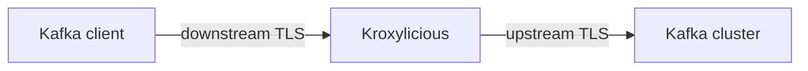



## What post-quantum cryptography is, and why it matters now

A large enough quantum computer running Shor's algorithm breaks the public-key cryptography that TLS relies on. The key exchange that protects a TLS session today uses classical algorithms such as elliptic-curve Diffie-Hellman. Those algorithms are secure against classical computers and insecure against a cryptographically relevant quantum computer.

No such machine exists yet. The reason this matters now is 'harvest now, decrypt later'. An adversary records encrypted traffic today and stores it. When a capable quantum computer arrives, they decrypt the stored traffic and recover the session keys, and with them the data. Any data with a long confidentiality lifetime is already exposed, as it's being recorded today whilst the means to decrypt it is only a matter of time.

Post-quantum cryptography addresses this with algorithms that are secure against both classical and quantum computers. The first priority is the key exchange, as that's what 'harvest now, decrypt later' targets. Protecting the key exchange with a post-quantum algorithm means traffic recorded today yields nothing decryptable later, even once a quantum computer exists.


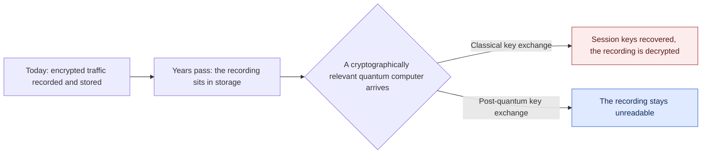



## Named groups and where they fit in the TLS handshake

A 'named group' identifies the algorithm and parameters used for the key exchange in a TLS handshake. In TLS 1.3 the client offers a list of supported named groups in its 'ClientHello', in preference order, along with a key share for the groups it expects to be chosen. The server picks one group that it also supports, and the key exchange proceeds with that group. When the client and server have no named group in common, the handshake fails.


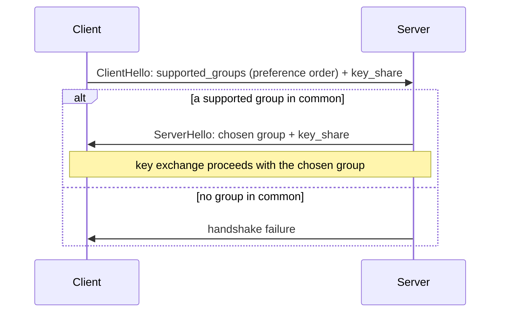



Two classical named groups appear throughout this post. 'X25519' is an elliptic-curve group and the common default on modern JDKs. 'secp256r1' is the NIST P-256 elliptic curve.

The post-quantum named group is 'X25519MLKEM768'. It's a hybrid, combining classical X25519 with ML-KEM-768, the post-quantum key encapsulation mechanism standardised as FIPS 203. The hybrid provides post-quantum protection for the key exchange whilst retaining the classical security of X25519, so a weakness later found in either component still leaves the other protecting the session.

Whether X25519MLKEM768 is available at all depends on your JDK vendor, for example the [JRE and JDK cryptographic roadmap](https://www.java.com/en/jre-jdk-cryptoroadmap.html) shows Java 25 support as already available, whilst Java 21 support is targeted for 2027. This JDK dependency is central to the scenarios below, as the named group a connection can use is bounded by what the JVM on each end supports, not only by what Kroxylicious is configured to allow.

## Controlling named groups in Kroxylicious

The 0.26 release adds a `namedGroups` block to the TLS configuration, alongside the existing controls for TLS protocol versions and cipher suites. It follows the same shape, an `allowed` list and a `denied` list.

```yaml
namedGroups:
  allowed: [X25519MLKEM768, X25519, secp256r1]
```

The order of the `allowed` list is significant. The first entry is the most preferred, and the remaining entries are fallbacks in preference order. An endpoint that permits post-quantum with a classical fallback lists X25519MLKEM768 first, then the classical groups.

```yaml
namedGroups:
  allowed: [X25519MLKEM768]
```

An `allowed` list with a single entry is a post-quantum-only endpoint. It offers no classical fallback, so a peer that cannot do X25519MLKEM768 has no group in common and the handshake fails.

```yaml
namedGroups:
  denied: [X25519]
```

A `denied` list removes groups from the JDK's default set rather than replacing it. Denying X25519 leaves the remaining default groups in their default preference order.

The `namedGroups` block is optional. When it's unset, the JDK's standard groups apply in the JDK's default order. This is the behaviour on an upgrade from 0.25 or earlier, where no configuration mentions named groups.

The two walkthroughs that follow apply this configuration on each side of the proxy in turn. Both were recorded end to end, and the full videos are in the appendix.

## Downstream: client to Kroxylicious

The downstream connection is the one from a Kafka client to a Kroxylicious proxy. The `namedGroups` block sits in the gateway's TLS configuration under `virtualClusters/gateways`. Kroxylicious is the TLS server for this connection, so the group that can be negotiated is bounded by both the JVM Kroxylicious runs on and what algorithms the client supports.


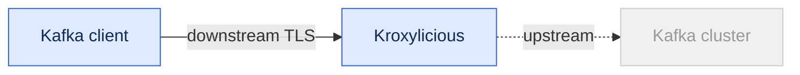

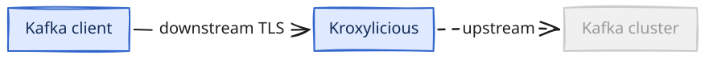

The walkthrough was recorded with two terminals side by side. The left terminal shows the Kroxylicious configuration in use. The right terminal runs a tool that reports the named group negotiated when a TLS connection is made to the proxy.

### Kroxylicious on Java 21

The first four scenarios all run with Kroxylicious on Java 21, changing only the gateway's `namedGroups` configuration between them.

With no `namedGroups` configured, the migration-from-0.25 case, the client negotiates X25519. The JDK's default most-preferred group applies on both ends.

```yaml
virtualClusters:
  - name: services
    target:
      cluster: kafka
    gateways:
      - name: sni
        sniHostIdentifiesNode:
          bootstrapAddress: bootstrap.kroxy.test:19192
          advertisedBrokerAddressPattern: broker-$(nodeId).kroxy.test
        tls:
          key:
            privateKeyFile: /certs/tls.key
            certificateFile: /certs/tls.crt
```
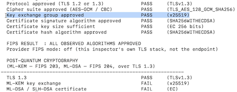

Adding a `denied` list for X25519 removes it from the default set, and the client then negotiates secp256r1, the next group in the default preference order.

```yaml
virtualClusters:
  - name: services
    target:
      cluster: kafka
    gateways:
      - name: sni
        sniHostIdentifiesNode:
          bootstrapAddress: bootstrap.kroxy.test:19192
          advertisedBrokerAddressPattern: broker-$(nodeId).kroxy.test
        tls:
          key:
            privateKeyFile: /certs/tls.key
            certificateFile: /certs/tls.crt
        namedGroups:
          denied:
            - x25519
```
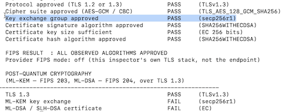

Setting an `allowed` list of `[X25519MLKEM768, X25519]` offers post-quantum first with a classical fallback. The client negotiates X25519, not X25519MLKEM768. The client is capable of post-quantum, however Kroxylicious is on Java 21, which does not offer X25519MLKEM768, so the handshake falls back to the first group the two ends share.

```yaml
virtualClusters:
  - name: services
    target:
      cluster: kafka
    gateways:
      - name: sni
        sniHostIdentifiesNode:
          bootstrapAddress: bootstrap.kroxy.test:19192
          advertisedBrokerAddressPattern: broker-$(nodeId).kroxy.test
        tls:
          key:
            privateKeyFile: /certs/tls.key
            certificateFile: /certs/tls.crt
        namedGroups:
          allowed:
            - X25519MLKEM768
            - x25519
```
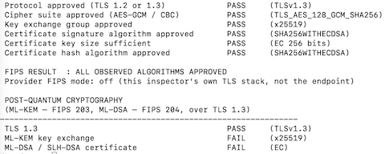

Restricting the `allowed` list to `[X25519MLKEM768]` removes the fallback. Kroxylicious on Java 21 cannot offer X25519MLKEM768, so there's no group in common and the client fails to connect.

```yaml
virtualClusters:
  - name: services
    target:
      cluster: kafka
    gateways:
      - name: sni
        sniHostIdentifiesNode:
          bootstrapAddress: bootstrap.kroxy.test:19192
          advertisedBrokerAddressPattern: broker-$(nodeId).kroxy.test
        tls:
          key:
            privateKeyFile: /certs/tls.key
            certificateFile: /certs/tls.crt
        namedGroups:
          allowed:
            - X25519MLKEM768
```
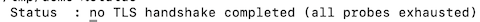

### Kroxylicious on Java 25

The final scenario keeps the same post-quantum-only configuration, `allowed: [X25519MLKEM768]`, and changes only the JVM. The Kroxylicious release is unchanged. On Java 25 the client negotiates X25519MLKEM768.

```yaml
virtualClusters:
  - name: services
    target:
      cluster: kafka
    gateways:
      - name: sni
        sniHostIdentifiesNode:
          bootstrapAddress: bootstrap.kroxy.test:19192
          advertisedBrokerAddressPattern: broker-$(nodeId).kroxy.test
        tls:
          key:
            privateKeyFile: /certs/tls.key
            certificateFile: /certs/tls.crt
        namedGroups:
          allowed:
            - X25519MLKEM768
```
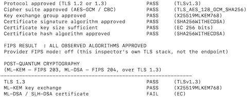

In summary, the outcome depends on the JVM, not the Kroxylicious release. The same configuration that fails to connect on Java 21 negotiates a post-quantum key exchange on Java 25.

| Kroxylicious JVM | `namedGroups` | Negotiated group |
|---|---|---|
| Java 21 | unset | X25519 |
| Java 21 | `denied: [X25519]` | secp256r1 |
| Java 21 | `allowed: [X25519MLKEM768, X25519]` | X25519 |
| Java 21 | `allowed: [X25519MLKEM768]` | none, connection fails |
| Java 25 | `allowed: [X25519MLKEM768]` | X25519MLKEM768 |

## Upstream: Kroxylicious to Kafka

The upstream connection is the one from Kroxylicious to the Kafka cluster. The `namedGroups` block sits in the upstream TLS configuration under `clusterDefinitions`. Here Kroxylicious is the TLS client and Kafka is the server, so the group that can be negotiated is bounded by both the JVM Kroxylicious runs on and the JVM Kafka runs on.


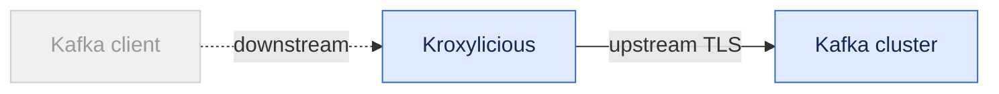

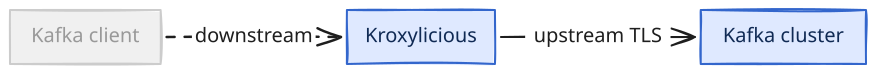

This walkthrough used the same two-terminal layout. The left terminal shows the Kroxylicious configuration. The right terminal shows the named group negotiated with the upstream Kafka, obtained by turning on TLS tracing for Kroxylicious with `-Djavax.net.debug=SSL` and filtering for the negotiated group. A producer sending a single message drove the upstream connection.

### Kroxylicious on Java 21, Kafka on Java 25

With no `namedGroups` configured, the migration-from-0.25 case, Kroxylicious negotiates X25519 with Kafka.

```yaml
clusterDefinitions:
  - name: kafka
    bootstrapServers: kafka.kroxy.test:9094
    tls:
      trust:
        storeFile: /certs/ca.crt
        storeType: PEM

```
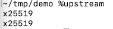

Adding a `denied` list for X25519 leads Kroxylicious to negotiate secp256r1 with Kafka, the next group in the default order.

```yaml
clusterDefinitions:
  - name: kafka
    bootstrapServers: kafka.kroxy.test:9094
    tls:
      trust:
        storeFile: /certs/ca.crt
        storeType: PEM
      namedGroups:
        denied:
          - x25519
```

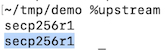

Restricting the `allowed` list to `[X25519MLKEM768]` leaves no classical fallback. Kroxylicious on Java 21 cannot offer X25519MLKEM768, so there's no group in common and Kroxylicious fails to connect to Kafka, even though Kafka on Java 25 could do it.

```yaml
clusterDefinitions:
  - name: kafka
    bootstrapServers: kafka.kroxy.test:9094
    tls:
      trust:
        storeFile: /certs/ca.crt
        storeType: PEM
      namedGroups:
        allowed:
          - X25519MLKEM768
```
There's no handshake inspection to show for this case. The upstream named group is read from the SSL trace, and when there's no group in common the handshake fails before a group is chosen, so there's nothing to capture. The connection simply fails.

### Kroxylicious on Java 25

The final scenario keeps `allowed: [X25519MLKEM768]` and changes only the Kroxylicious JVM to Java 25. Both ends can now do the post-quantum group, and Kroxylicious negotiates X25519MLKEM768 with Kafka.

```yaml
clusterDefinitions:
  - name: kafka
    bootstrapServers: kafka.kroxy.test:9094
    tls:
      trust:
        storeFile: /certs/ca.crt
        storeType: PEM
      namedGroups:
        allowed:
          - X25519MLKEM768
```
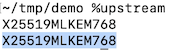

Similar to connections from downstream clients, the outcome depends on the JVM, not the Kroxylicious release. The same configuration that fails to connect on Java 21 negotiates a post-quantum key exchange on Java 25.

| Kroxylicious JVM | Kafka JVM | `namedGroups` | Negotiated group |
|---|---|---|---|
| Java 21 | Java 25 | unset | X25519 |
| Java 21 | Java 25 | `denied: [X25519]` | secp256r1 |
| Java 21 | Java 25 | `allowed: [X25519MLKEM768]` | none, connection fails |
| Java 25 | Java 25 | `allowed: [X25519MLKEM768]` | X25519MLKEM768 |

Kafka can run a post-quantum key exchange given a suitable JVM. Control over the named groups Kafka offers is proposed in [KIP-1376](https://cwiki.apache.org/confluence/spaces/KAFKA/pages/451974516/KIP-1376+Support+setting+TLS+named+groups).

## Recap

The 0.26 release of Kroxylicious lets users control the TLS named groups negotiated on both sides of the proxy, through a `namedGroups` block with `allowed` and `denied` lists on the downstream gateway and the upstream cluster configuration. The order of the `allowed` list sets the preference order, and leaving the block unset keeps the JDK's defaults, so an upgrade from 0.25 or earlier changes nothing.

Listing X25519MLKEM768 in the `allowed` list is what asks for a post-quantum key exchange. Whether that's negotiated then depends on what is supported at each end of the connection. On Java 25 both the downstream and the upstream connection negotiate X25519MLKEM768. On Java 21 the post-quantum group is not yet available, so a configuration that permits a classical fallback negotiates a classical group, and a post-quantum-only configuration fails to connect. Java 21 support is scheduled for a backport in the first half of 2027.

## Appendix: the recordings

The downstream walkthrough, client to Kroxylicious used a two-terminal layout. The left terminal shows the Kroxylicious configuration in use. The right terminal runs a tool that reports the named group negotiated when a TLS connection is made to the proxy.

<video controls muted playsinline width="720" preload="metadata">
  <source src="/assets/blog/videos/pqc-series/kroxy-downstream-pqc.mp4" type="video/mp4">
  Your browser does not support the video element. The recording is at
  <a href="/assets/blog/videos/pqc-series/kroxy-downstream-pqc.mp4">downstream-named-groups.mp4</a>.
</video>

The upstream walkthrough, Kroxylicious to Kafka used a two-terminal layout. The left terminal shows the Kroxylicious configuration. The right terminal shows the named group negotiated with the upstream Kafka, obtained by turning on TLS tracing for Kroxylicious with `-Djavax.net.debug=SSL` and filtering for the negotiated group. A producer sending a single message drove the upstream connection.

<video controls muted playsinline width="720" preload="metadata">
  <source src="/assets/blog/videos/pqc-series/kroxy-upstream-pqc.mp4" type="video/mp4">
  Your browser does not support the video element. The recording is at
  <a href="/assets/blog/videos/pqc-series/kroxy-upstream-pqc.mp4">upstream-named-groups.mp4</a>.
</video>
